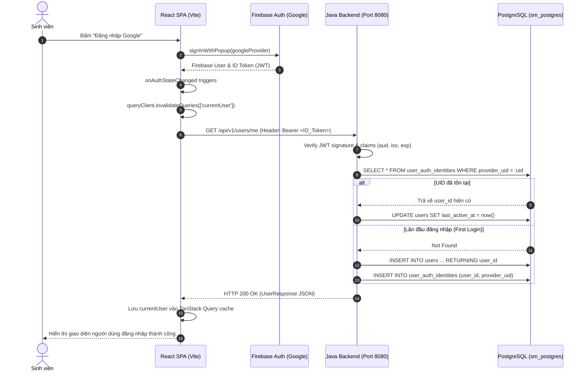
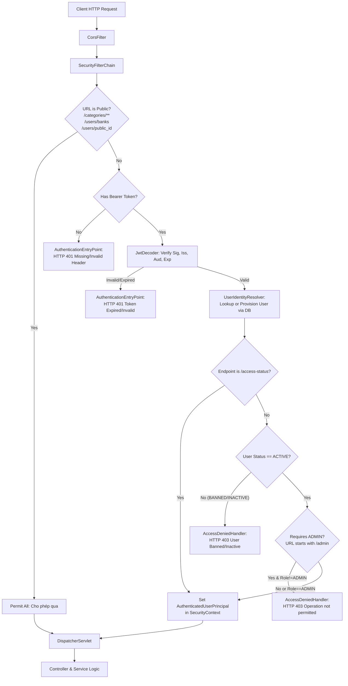
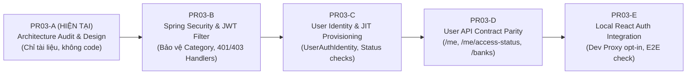

# THIẾT KẾ KIẾN TRÚC XÁC THỰC VÀ ĐỊNH DANH NGƯỜI DÙNG (AUTH & IDENTITY MIGRATION DESIGN)
# Repository: marketplace-ptit-be — Phase 3: Security & Identity Migration
# Tài liệu tham chiếu chuẩn mực cho việc di trú từ Python FastAPI sang Java 21 / Spring Boot 4.1.1

---

## 1. PHẠM VI & HIỆN TRẠNG KIẾN TRÚC XÁC THỰC PYTHON (PYTHON AUTH ARCHITECTURE)

### 1.1. Hiện trạng triển khai trong Backend Python (`student-marketplace-be`)
Qua kiểm toán trực tiếp mã nguồn tại `app/modules/auth/`, `app/modules/users/`, và `app/integrations/firebase.py`:

1. **Nhà cung cấp danh tính duy nhất (Single Provider)**:
   - Hệ thống hiện tại chỉ hỗ trợ duy nhất `FIREBASE`.
   - Ràng buộc CSDL: `chk_user_auth_identities_provider CHECK (provider = 'FIREBASE')`.
2. **Cơ chế xác thực Token Firebase**:
   - Sử dụng thư viện `firebase_admin.auth.verify_id_token(token)`.
   - Token là JWT được ký bởi Google private keys, client gửi qua header `Authorization: Bearer <token>`.
   - Hàm `verify_firebase_token` kiểm tra: chữ ký số (Google public certs), `iss` (`https://securetoken.google.com/<projectId>`), `aud` (`<projectId>`), `exp` (thời hạn 60 phút), và `sub` (Firebase UID).
   - Mặc định tham số `check_revoked` là `False` (không gọi Firebase REST API để kiểm tra thu hồi token ở từng request, nhằm tối ưu hiệu năng).
3. **Cơ chế Định danh và Khởi tạo Tự động (Just-In-Time Provisioning)**:
   - Không có API riêng cho `/login` hay `/register`.
   - Khi có request kèm Bearer token tới bất kỳ endpoint yêu cầu xác thực nào (tiêu biểu là `GET /api/v1/users/me`), hàm `AuthService.get_or_create_user_from_token_payload` xử lý:
     - Trích xuất `provider_uid = token_payload["uid"]`.
     - Tìm kiếm trong bảng `user_auth_identities` theo `(provider="FIREBASE", provider_uid)`.
     - **Nếu đã tồn tại**: Cập nhật `last_active_at = now()` và `avatar_url` (nếu Google photo thay đổi), commit và trả về `User`.
     - **Nếu chưa tồn tại (First Login)**:
       - Lấy `email = token_payload.get("email")` (hoặc fallback `{uid}@firebase.user`).
       - Lấy `full_name = token_payload.get("name")` (hoặc prefix email).
       - Kiểm tra email đã có trong bảng `users` chưa. Nếu có, liên kết thêm bản ghi `UserAuthIdentity`. Nếu chưa, tạo mới `User(role='STUDENT', status='ACTIVE')` cùng `UserAuthIdentity` trong một transaction duy nhất.
       - Xử lý race condition đồng thời qua khối `try...except IntegrityError` (nếu có 2 request đồng thời từ browser, transaction thứ hai rollback và query lại).
4. **Phân quyền và Kiểm soát Trạng thái Tài khoản**:
   - `get_current_user`: Trả về `User` bất kể trạng thái (dành riêng cho endpoint `GET /api/v1/users/me/access-status`).
   - `get_current_active_user`: Chặn người dùng `BANNED` (`HTTP 403: "User account is banned."`) và `INACTIVE` (`HTTP 403: "User account is inactive."`).
   - `require_role(UserRole.ADMIN)`: Chặn người dùng không có vai trò `ADMIN` (`HTTP 403: "Operation not permitted for your user role."`).
   - Quyền nghiệp vụ (`can_buy`, `can_sell`): Được kiểm tra động thông qua bảng `user_capability_restrictions` (`CapabilityService`). Admin tự động bỏ qua hạn chế.

---

## 2. LUỒNG XÁC THỰC TRÊN FRONTEND REACT (FRONTEND AUTHENTICATION FLOW)

Kiểm toán từ `student-marketplace-fe/src/lib/firebase.ts`, `AuthContext.tsx`, `apiClient.ts`, và `features/users/`:



### Điểm kỹ thuật cốt lõi của Frontend:
1. **Lưu trữ & Truyền Token**: Token được lấy từ bộ nhớ của Firebase Client SDK (`auth.currentUser.getIdToken()`), đính kèm vào header `Authorization: Bearer <token>` trên mỗi request bởi Axios request interceptor. Không sử dụng Cookie.
2. **Tự động làm mới Token (Auto Refresh on 401)**:
   - Khi token hết hạn (sau 60 phút) và backend trả về 401, Axios response interceptor tại `apiClient.ts` sử dụng cơ chế `refreshPromise` (single-flight shared promise) để gọi `user.getIdToken(true)` làm mới token từ Google.
   - Axios gán lại Bearer token mới và retry request gốc duy nhất 1 lần (`_retry = true`).
3. **Xử lý Tài khoản bị Khóa (403 Banned/Inactive)**:
   - Khi API trả về 403 với nội dung chứa `banned`, `inactive`, hoặc `tài khoản đã bị khóa`, Axios interceptor tự động chuyển hướng người dùng tới trang thông báo `/account-restricted`.
4. **Đăng xuất (Logout)**:
   - Gọi `signOut(auth)` của Firebase SDK để xóa token cục bộ trên trình duyệt.
   - Hủy bỏ và xóa sạch bộ nhớ đệm React Query (`currentUser`, `myBankAccount`, `notifications`). Không có cuộc gọi revoke token lên backend.

---

## 3. THIẾT KẾ CSDL & ÁNH XẠ ĐỊNH DANH (DATABASE USER / IDENTITY MAPPING)

### 3.1. Cấu trúc CSDL PostgreSQL thực tế
Kiểm toán từ `information_schema` và lệnh `\d` trên container `sm_postgres` (database `marketplace_java_dev`):

```sql
-- Bảng users
CREATE TABLE public.users (
    user_id bigint GENERATED BY DEFAULT AS IDENTITY PRIMARY KEY,
    public_id uuid NOT NULL DEFAULT gen_random_uuid() UNIQUE,
    email varchar(150) NOT NULL UNIQUE,
    full_name varchar(100) NOT NULL,
    phone varchar(20),
    avatar_url varchar(500),
    bio varchar(500),
    delivery_area varchar(255),
    default_meetup_area varchar(255),
    bank_bin varchar(10),
    bank_account_number varchar(30),
    bank_account_name varchar(100),
    role varchar(10) NOT NULL DEFAULT 'STUDENT' CHECK (role IN ('STUDENT', 'ADMIN')),
    status user_status NOT NULL DEFAULT 'ACTIVE',
    show_phone_publicly boolean NOT NULL DEFAULT false,
    social_links json,
    last_active_at timestamp without time zone,
    created_at timestamp without time zone NOT NULL DEFAULT now(),
    updated_at timestamp without time zone NOT NULL DEFAULT now()
);

-- Bảng user_auth_identities
CREATE TABLE public.user_auth_identities (
    user_auth_identity_id bigint GENERATED BY DEFAULT AS IDENTITY PRIMARY KEY,
    user_id bigint NOT NULL REFERENCES users(user_id) ON DELETE CASCADE,
    provider varchar(30) NOT NULL DEFAULT 'FIREBASE' CHECK (provider = 'FIREBASE'),
    provider_uid varchar(128) NOT NULL,
    created_at timestamp without time zone NOT NULL DEFAULT now(),
    updated_at timestamp without time zone NOT NULL DEFAULT now(),
    CONSTRAINT ux_user_auth_identities_provider_uid UNIQUE (provider, provider_uid),
    CONSTRAINT ux_user_auth_identities_user_id UNIQUE (user_id)
);
```

### 3.2. Phân tích Ràng buộc Quan hệ: 1:1 vs 1:N
- **Phát hiện quan trọng**: Trong PostgreSQL, cột `user_id` của bảng `user_auth_identities` mang ràng buộc duy nhất: `CONSTRAINT ux_user_auth_identities_user_id UNIQUE (user_id)`.
- **Hệ quả CSDL**: Tại một thời điểm, mỗi người dùng (`users`) chỉ có thể liên kết với **duy nhất một danh tính** (`user_auth_identities`). Đây là quan hệ **1:1 thực sự (True One-to-One)**.
- **Thực trạng Java Entity**:
  - `UserAuthIdentity.java` hiện tại đang ánh xạ `@ManyToOne(fetch = FetchType.LAZY) @JoinColumn(name = "user_id")`.
  - Về mặt kỹ thuật, Hibernate `ddl-auto: validate` vẫn chấp nhận `@ManyToOne` trên một foreign key column có unique index.
  - Tuy nhiên, về mặt thiết kế nghiệp vụ và tính toàn vẹn miền (Domain Integrity), việc chuyển sang `@OneToOne` hoặc thiết lập phương thức truy vấn `findByUserId(Long userId)` là cần thiết để bảo đảm logic Java không bao giờ giả định một user có thể có danh sách nhiều identities.
  - Trong Phase 3-C, khuyến nghị giữ `@ManyToOne` hoặc chuyển `@OneToOne` có kiểm soát, đi kèm phương thức `Optional<UserAuthIdentity> findByUserId(Long userId)` trong repository.

---

## 4. ĐỀ XUẤT KIẾN TRÚC XÁC THỰC TRÊN JAVA SPRING BOOT

### 4.1. So sánh 2 Phương án Xác thực Token Firebase

| Tiêu chí | Phương án A: Firebase Admin Java SDK | Phương án B: Spring Security OAuth2 Resource Server (Khuyến nghị) |
| :--- | :--- | :--- |
| **Thư viện** | `com.google.firebase:firebase-admin:9.x` | `org.springframework.boot:spring-boot-starter-oauth2-resource-server` |
| **Cơ chế xác thực** | `FirebaseAuth.getInstance().verifyIdToken(token)` | Standard Nimbus JWT Decoder qua Google JWK Set URI (`https://www.googleapis.com/service_accounts/v1/jwk/securetoken@system.gserviceaccount.com`) |
| **Phụ thuộc bên ngoài** | Mang theo nhiều thư viện phụ thuộc bắc cầu (gRPC, Guava, Netty), làm tăng kích thước artifact. | Tối thiểu (Nằm trong hệ sinh thái chuẩn của Spring Boot 4.1.1). |
| **Xác thực Offline / Không cần Network** | Cần mock singleton `FirebaseAuth`, khó kiểm thử đơn vị độc lập. | Rất dễ mock `JwtDecoder` trong integration tests; có thể kiểm thử toàn bộ Filter chain với JWT giả lập mà không cần kết nối mạng hay file credential. |
| **Chi phí kiểm tra Thu hồi (checkRevoked)** | Mặc định tắt; nếu bật sẽ tốn thêm 1 network roundtrip ~200ms tới Google. | Mặc định dựa trên chữ ký và thời hạn `exp`; phù hợp hoàn toàn với chính sách bảo mật hiện tại của Python backend. |
| **Tính tương thích Spring Security** | Cần viết custom `OncePerRequestFilter` thủ công để trích xuất header và set `SecurityContext`. | Tích hợp gốc và liền mạch thông qua `.oauth2ResourceServer(oauth2 -> oauth2.jwt(...))`. |

### 4.2. Khuyến nghị Kiến trúc (Architectural Decision)
**Lựa chọn: PHƯƠNG ÁN B (Spring Security OAuth2 Resource Server với JWT Validator chuẩn)**.
- Tận dụng `NimbusJwtDecoder` được cấu hình với:
  - `JwkSetUri`: `https://www.googleapis.com/service_accounts/v1/jwk/securetoken@system.gserviceaccount.com`
  - `IssuerUri`: `https://securetoken.google.com/student-marketplace-ptit`
  - `AudienceValidator`: Khẳng định `aud` chứa `student-marketplace-ptit`.
- Đóng gói logic chuyển đổi JWT sang `AuthenticatedUserPrincipal` qua một `Converter<Jwt, AbstractAuthenticationToken>` (hoặc custom filter gọn gàng).
- Cho phép hoán đổi hoặc stub `JwtDecoder` trong profile `test` để kiểm thử tự động đạt độ tin cậy 100% mà không phụ thuộc internet hay secret production.

---

## 5. THIẾT KẾ SPRING SECURITY FILTER CHAIN & REQUEST FLOW



### Chi tiết các thành phần Spring Security:
1. **`SecurityFilterChain`**:
   - `csrf(AbstractHttpConfigurer::disable)`: Tắt CSRF vì API hoàn toàn stateless.
   - `sessionManagement(s -> s.sessionCreationPolicy(SessionCreationPolicy.STATELESS))`: Không tạo HTTP session.
   - `authorizeHttpRequests`:
     - `/api/v1/categories/**`: `permitAll()` (Bảo vệ tuyệt đối PR02).
     - `/api/v1/users/banks`: `permitAll()`.
     - `/api/v1/users/{public_id}/**`: `permitAll()`.
     - `/api/v1/users/me/access-status`: `authenticated()`.
     - `/api/v1/users/me/**`: `authenticated()`.
     - `/api/v1/admin/**`: `hasRole('ADMIN')`.
     - Mọi request khác: `authenticated()`.
2. **`AuthenticationEntryPoint`**:
   - Trả về mã HTTP 401 với JSON: `{"detail": "Missing or invalid Authorization header."}` (hoặc lý do token hết hạn/không hợp lệ).
3. **`AccessDeniedHandler`**:
   - Trả về mã HTTP 403 với JSON: `{"detail": "Operation not permitted for your user role."}` hoặc thông báo tài khoản bị khóa.

---

## 6. MA TRẬN HỢP ĐỒNG API USER & AUTHENTICATION (ENDPOINT MATRIX)

| HTTP Method | Đường dẫn Endpoint | Yêu cầu Xác thực (Auth) | Phân quyền (RBAC / Status) | Payload Request | Response Thành công | Phản hồi Lỗi tiêu chuẩn | Tác động CSDL | Mức độ Ưu tiên |
| :--- | :--- | :--- | :--- | :--- | :--- | :--- | :--- | :---: |
| `GET` | `/api/v1/categories` | Public | None | None | 200 `CategoryResponse[]` | Không | Read | P0 (Đã hoàn thành) |
| `GET` | `/api/v1/categories/{id}` | Public | None | None | 200 `CategoryResponse` | 404 `Category not found.` | Read | P0 (Đã hoàn thành) |
| `GET` | `/api/v1/users/banks` | Public | None | None | 200 `BankInfo[]` | Không | Static Read | P1 (PR03-D) |
| `GET` | `/api/v1/users/{public_id}` | Public | None | None | 200 `PublicUserProfile` | 404 `User not found.` | Read | P1 (PR03-D) |
| `GET` | `/api/v1/users/{public_id}/sold-products` | Public | None | None | 200 `SoldProductList` | 404 `User not found.` | Read | P2 (PR03-D) |
| `GET` | `/api/v1/users/me/access-status` | Authenticated | Cho phép `BANNED`, `INACTIVE` | None | 200 `UserAccessStatus` | 401 Unauthorized | Read + JIT Provision | P1 (PR03-D) |
| `GET` | `/api/v1/users/me` | Authenticated | Bắt buộc `ACTIVE` | None | 200 `UserResponse` | 401 Unauth / 403 Forbidden | Read + JIT / Update `last_active` | P0 (PR03-D) |
| `PATCH` | `/api/v1/users/me` | Authenticated | Bắt buộc `ACTIVE` | `UserUpdate` | 200 `UserResponse` | 401 Unauth / 403 Forbidden / 422 | Update `users` | P1 (PR03-D) |
| `GET` | `/api/v1/users/me/bank-account` | Authenticated | Bắt buộc `ACTIVE` | None | 200 `BankAccount` (hoặc null) | 401 Unauth / 403 Forbidden | Read `users` | P2 (PR03-D) |
| `PUT` | `/api/v1/users/me/bank-account` | Authenticated | Bắt buộc `ACTIVE` | `BankAccountUpdate` | 200 `BankAccount` | 401 Unauth / 403 Forbidden / 422 | Update `users` | P2 (PR03-D) |
| `DELETE`| `/api/v1/users/me/bank-account` | Authenticated | Bắt buộc `ACTIVE` | None | 204 No Content | 401 Unauth / 403 Forbidden | Update `users` (nullify) | P2 (PR03-D) |
| `GET` | `/api/v1/users/search` | Authenticated | Bắt buộc `ACTIVE` | Query `q`, `limit` | 200 `UserSearchResponse[]` | 401 Unauth / 403 Forbidden | Read `users` | P3 (Giai đoạn Chat) |
| `GET` | `/api/v1/admin/users` | Authenticated | Bắt buộc `ADMIN` & `ACTIVE` | Query pagination | 200 `AdminUserList` | 401 Unauth / 403 Forbidden | Read `users` | P3 (Giai đoạn Admin) |

---

## 7. ĐÁNH GIÁ MỐI ĐE DỌA BẢO MẬT & XUNG ĐỘT HỆ THỐNG (SECURITY THREATS & CONFLICTS)

### 7.1. Phân tích các mối đe dọa bảo mật cốt lõi
1. **Giả mạo UID người dùng (User ID Spoofing)**:
   - *Nguy cơ*: Client tự truyền `user_id` trong request body để mạo danh người khác.
   - *Giải pháp*: Tuyệt đối không đọc `user_id` từ client payload. `user_id` luôn được phân giải an toàn từ `SecurityContextHolder` (được trích xuất từ chữ ký số của Firebase ID Token).
2. **Leo thang đặc quyền vai trò (Role Escalation)**:
   - *Nguy cơ*: Client gửi claim `role=ADMIN` tự chế trong token hoặc request body.
   - *Giải pháp*: Backend bỏ qua toàn bộ custom claims về role trong token; `role` và `status` được nạp 100% từ bảng `users` trong PostgreSQL.
3. **Race Condition khi Tạo tài khoản mới (Concurrent Provisioning)**:
   - *Nguy cơ*: Khi người dùng đăng nhập lần đầu, frontend có thể gửi song song nhiều request (`/users/me`, `/users/me/access-status`). Hai transaction có thể cùng cố gắng `INSERT` với cùng một email hoặc provider_uid.
   - *Giải pháp*: Bắt `DataIntegrityViolationException` tại tầng repository/service trong Java, tự động rollback và truy vấn lại bản ghi vừa được tạo thành công bởi transaction đồng thời.
4. **Hồi quy quyền truy cập danh mục Public (Public Endpoint Regression)**:
   - *Nguy cơ*: Thêm Spring Security chặn toàn bộ `/api/**`, khiến `GET /api/v1/categories` bị trả về 401, làm hỏng frontend của Phase 2.
   - *Giải pháp*: Thêm bài test hồi quy bắt buộc trong bộ test tự động khẳng định `/api/v1/categories` luôn trả về 200 OK khi không có Authorization header.

### 7.2. Bảng phân loại xung đột di trú (Migration Conflicts)

| Xung đột | Mức độ | Bằng chứng mã nguồn / CSDL | Tác động tiềm tàng | Khuyến nghị hành động | Task xử lý |
| :--- | :---: | :--- | :--- | :--- | :---: |
| **Spring Security chặn Category API** | **P0** | Mặc định Spring Security bảo vệ toàn bộ route | Frontend Phase 2 crash với lỗi 401 khi xem trang chủ | Khai báo tường minh `permitAll()` cho `/api/v1/categories/**` | PR03-B |
| **Định dạng lỗi 401/403 lệch chuẩn FastAPI** | **P1** | Spring Security mặc định sinh ProblemDetail / HTML | Frontend interceptor không lấy được `detail`, báo lỗi không thân thiện | Cấu hình `AuthenticationEntryPoint` và `AccessDeniedHandler` trả về `{"detail": "..."}` | PR03-B |
| **Race condition JIT Provisioning** | **P1** | Ràng buộc `ux_users_email` & `ux_user_auth_identities_provider_uid` | Ném lỗi 500 khi client gửi nhiều request đồng thời lúc mới login | Bắt `DataIntegrityViolationException` và retry select | PR03-C |
| **Ràng buộc Unique `user_id` trong `user_auth_identities`** | **P1** | `ux_user_auth_identities_user_id` trong PostgreSQL | `@ManyToOne` trong Java có thể gây hiểu nhầm mô hình dữ liệu cho phép 1:N | Giữ Java an toàn, đảm bảo nghiệp vụ chỉ thao tác 1:1, thêm unit test kiểm chứng | PR03-C |
| **Khác biệt chi tiết lỗi 422** | **P2** | FastAPI trả về mảng `loc/msg`, Java trả về chuỗi String | Không ảnh hưởng do `apiErrors.ts` hỗ trợ chuỗi, nhưng payload chưa byte-parity | Giữ nguyên String hiện tại, chuẩn hóa khi làm DTO validation | PR03-D |

---

## 8. CHIẾN LƯỢC KIỂM THỬ (TESTING STRATEGY)

Tuân thủ nguyên tắc: **Tuyệt đối không yêu cầu production credentials và không gọi ra ngoài internet trong kiểm thử tự động.**

1. **Kiểm thử Đơn vị (Unit Tests)**:
   - Kiểm thử `UserIdentityResolver`: Truyền `Jwt` giả lập, kiểm tra logic tìm thấy user, link identity, tạo mới user, và xử lý race condition.
   - Kiểm thử `CapabilityService`: Kiểm tra quyền BUY/SELL theo các trạng thái ACTIVE, BANNED, INACTIVE, và vai trò ADMIN/STUDENT.
2. **Kiểm thử Tích hợp HTTP (MockMvc Integration Tests trên `marketplace_java_test`)**:
   - `testPublicCategoryRemainsAccessibleWithoutToken`: Gọi `GET /api/v1/categories` không có header -> Khẳng định HTTP 200 OK (Ngăn chặn hồi quy).
   - `testProtectedEndpointWithoutTokenReturns401`: Gọi `GET /api/v1/users/me` không có header -> Khẳng định HTTP 401 `{"detail": "Missing or invalid Authorization header."}`.
   - `testProtectedEndpointWithInvalidTokenReturns401`: Gọi với token sai định dạng -> Khẳng định HTTP 401.
   - `testValidTokenProvisionsNewUserAndReturns200`: Gọi với JWT giả lập hợp lệ -> Khẳng định HTTP 200, tạo đúng bản ghi trong `users` và `user_auth_identities`.
   - `testBannedUserReturns403`: Người dùng có `status = BANNED` gọi `/api/v1/users/me` -> Khẳng định HTTP 403 `{"detail": "User account is banned."}`.
   - `testBannedUserCanAccessAccessStatus`: Người dùng `BANNED` gọi `/api/v1/users/me/access-status` -> Khẳng định HTTP 200 OK.
   - `testNonAdminAccessingAdminRouteReturns403`: Sinh viên gọi `/api/v1/admin/users` -> Khẳng định HTTP 403 `{"detail": "Operation not permitted for your user role."}`.
3. **Cơ chế Giả lập JWT an toàn cho Kiểm thử (Synthetic Test JWTs)**:
   - Sử dụng `SecurityMockMvcRequestPostProcessors.jwt()` hoặc cấu hình test `JwtDecoder` trả về `Jwt` với claims mong muốn (`sub`, `email`, `name`, `picture`).
   - Không cần tải file private key thật hay kết nối tới Google Firebase Auth server trong lúc chạy `.\mvnw.cmd test`.

---

## 9. LỘ TRÌNH THỰC HIỆN TỪNG BƯỚC NHỎ (PHASED IMPLEMENTATION ROADMAP)



- **Task PR03-A (Nhiệm vụ Hiện tại)**: Khảo sát kiến trúc, phân tích mã nguồn Python/React thật, thiết kế giải pháp Java và lập kế hoạch di trú chi tiết. (Chỉ ghi tài liệu, không sửa code ứng dụng).
- **Task PR03-B (Spring Security Foundation & Token Verification)**:
  - Bổ sung dependency `spring-boot-starter-oauth2-resource-server` vào `pom.xml`.
  - Thiết lập `SecurityFilterChain` mở quyền cho `/api/v1/categories/**` và bảo vệ các route khác.
  - Cấu hình `AuthenticationEntryPoint` và `AccessDeniedHandler` trả về JSON theo chuẩn FastAPI.
  - Viết bộ kiểm thử MockMvc xác nhận Category API vẫn public và endpoint bảo vệ trả về 401.
- **Task PR03-C (User Identity Resolution & JIT Auto-Provisioning)**:
  - Bổ sung `UserAuthIdentityRepository` và `UserService.getOrCreateUserFromToken`.
  - Triển khai logic tạo người dùng lần đầu, đồng bộ avatar, cập nhật `last_active_at`, và xử lý race condition.
  - Kiểm thử tích hợp toàn diện trên database `marketplace_java_test`.
- **Task PR03-D (User API Contract Parity)**:
  - Triển khai `UserController` với các endpoint: `GET /api/v1/users/me`, `GET /api/v1/users/me/access-status`, `GET /api/v1/users/banks`, `GET /api/v1/users/{public_id}`.
  - Đối soát khớp 100% hợp đồng API và DTO serialization.
- **Task PR03-E (Local React Frontend Integration)**:
  - Cấu hình opt-in proxy trong `student-marketplace-fe/vite.config.ts` (`JAVA_USER_PROXY=1`).
  - Kiểm chứng frontend đăng nhập Google và gọi API sang Java backend cổng 8080.

---

## 10. CÁC GIẢ ĐỊNH CHƯA XÁC MINH & YẾU TỐ CHẶN (BLOCKERS & UNVERIFIED ITEMS)

1. **Môi trường Firebase Production trên VPS**:
   - Việc backend Python trên VPS có sử dụng cùng project Firebase `student-marketplace-ptit` hay không đã được xác nhận (khớp với file cấu hình frontend).
   - Tuy nhiên, file service account JSON của Firebase trên VPS là private, không thể và không được phép truy cập. Môi trường Java cục bộ sẽ dựa trên xác thực JWT công khai (OAuth2 Resource Server qua Google JWK endpoint công khai) để không cần file service account bí mật.
2. **WebSocket Authentication (`/ws/...`)**:
   - WebSocket hiện tại vẫn chạy trên backend Python cổng 8000. Việc di trú xác thực WebSocket sang Java sẽ được thực hiện riêng trong giai đoạn Chat / Realtime sau này.

---
*Tài liệu này được phê duyệt làm kim chỉ nam kỹ thuật cho toàn bộ Phase 3 của dự án di trú Chợ PTITers.*

---

## 11. BẢN GHI HOÀN THÀNH TRIỂN KHAI VÀ GIA CỐ BẢO MẬT (PR03-B & PR03-B.1)

- **Thời điểm hoàn thành PR03-B & PR03-B.1**: 2026-11-22
- **Các lỗ hổng và rủi ro đã phát hiện & khắc phục triệt để**:
  1. **Public User Route Collision (P0/P1)**:
     - *Lỗ hổng cũ*: Cấu hình `/api/v1/users/{public_id}/**` dạng `permitAll()` quá rộng, vô tình làm cho `/api/v1/users/me`, `/api/v1/users/me/access-status`, `/api/v1/users/me/bank-account` và `/api/v1/users/search` không bị thách thức xác thực 401 khi truy cập ẩn danh.
     - *Khắc phục*: 
       - Đặt quy tắc bảo vệ tường minh `/api/v1/users/me`, `/api/v1/users/me/**`, `/api/v1/users/search` lên ĐẦU chuỗi `authorizeHttpRequests`.
       - Ràng buộc endpoint public chỉ chấp nhận định dạng UUID (`/api/v1/users/{publicId:[0-9a-fA-F]+-[0-9a-fA-F]+-[0-9a-fA-F]+-[0-9a-fA-F]+-[0-9a-fA-F]+}` và sub-path `/sold-products`), không dùng wildcard `/**`.
  2. **Loại bỏ giả định sai về quyền Admin (P1)**:
     - Trong ứng dụng này, vai trò `ADMIN`/`STUDENT` bắt nguồn từ CSDL `users.role`. Token Firebase ID không mang `scope=admin`.
     - Đã loại bỏ hoàn toàn matcher `/api/v1/test/admin` và `hasAuthority("SCOPE_admin")` khỏi production `SecurityConfig.java`. Việc phân quyền nghiệp vụ 403 dựa trên `users.role` và `users.status` được hoãn lại (deferred) sang Task PR03-C khi có User Identity Resolution.
  3. **Thắt chặt kiểm thực Audience Firebase (P1)**:
     - `JwtClaimValidator` kiểm tra nghiêm ngặt `aud` phải là danh sách có kích thước ĐÚNG BẰNG 1 và phần tử duy nhất đó phải bằng chính xác `projectId`. Token chứa nhiều audiences bị từ chối 100%.
  4. **Bổ sung toàn diện 14 kịch bản kiểm thực claims JWT (P1/P2)**:
     - `FirebaseJwtCustomValidator` kiểm tra bắt buộc: `kid` header (không rỗng), `sub` (không rỗng), `exp` (bắt buộc có), `iat` (bắt buộc có và không ở tương lai), `auth_time` (bắt buộc có, đúng kiểu numeric timestamp, không ở tương lai).
  5. **Khôi phục tính đóng gói của `Category.java` (P2)**:
     - Khôi phục `@NoArgsConstructor(access = AccessLevel.PROTECTED)` trong Entity sản xuất `Category.java`.
     - Chuyển logic tạo fixture sang `CategoryTestFixtures.java` trong package test `com.ptiters.marketplace.category`.
  6. **Gia cố CORS và chính sách an toàn**:
     - Cấu hình nguồn gốc rõ ràng (explicit origins: `localhost:3000`, `localhost:5173`, `127.0.0.1:3000`, `127.0.0.1:5173`).
     - Đặt `allowCredentials(false)` do API dùng Bearer tokens, loại bỏ rủi ro bảo mật CORS wildcard.
- **Giới hạn kỹ thuật còn tồn tại**:
  - Không hỗ trợ kiểm tra thu hồi token tức thời từ máy chủ Firebase (Firebase revocation check) do không dùng Firebase Admin network call; giải pháp này tương đồng với Python production backend.
  - Chưa hỗ trợ Redis token blacklist (chưa có phê duyệt kiến trúc).
  - PR03-B/B.1 không thực hiện JIT User provisioning hay DB identity lookup (thuộc phạm vi PR03-C).
  - Cấu trúc phản hồi lỗi 422 của Category vẫn có sự khác biệt nhỏ về schema (`errors` map vs danh sách lỗi Pydantic) so với FastAPI, nhưng hoàn toàn tương thích với frontend UI.
- **Kết quả kiểm thử tự động toàn diện**:
  - `FirebaseJwtValidatorTest.java`: **19/19 tests PASS** (A - N, kiểm tra đầy đủ mọi loại claims, headers, formats).
  - `SecurityIntegrationTest.java`: **23/23 tests PASS** (ma trận phân quyền ẩn danh, route collision, CORS, statelessness).
  - Toàn bộ test suite dự án: **63/63 tests PASS** (0 failures, 0 errors, 0 skipped).
- **Trạng thái CSDL**:
  - `marketplace_java_dev`: 286 users, 26 categories (nguyên vẹn).
  - `marketplace_java_test`: 0 users, 0 categories (rollback sạch sẽ sau kiểm thử).


---

## 12. BẢN GHI HOÀN THÀNH PR03-C, PR03-D1 VÀ PR03-E

- **PR03-C (User Identity Resolution & JIT Auto-Provisioning)**:
  - Triển khai `UserService`, `UserProvisioningService` với `@Transactional(propagation = Propagation.REQUIRES_NEW)`.
  - Bounded retry (2 lần) giải quyết xung đột ghi đồng thời (race condition) mà không bẩn giao dịch gốc.
  - Chống chiếm đoạt tài khoản (Anti-takeover): Ngăn chặn việc liên kết token mới vào tài khoản đã gắn với identity khác (HTTP 409 Conflict).
  - Ngăn chặn liên kết email giả định (`isSyntheticEmail` cấm fallback email `{uid}@firebase.user` liên kết vào người dùng cũ).
- **PR03-D1 (Current User & Access Status API Parity)**:
  - Triển khai `UserController` với `GET /api/v1/users/me` và `GET /api/v1/users/me/access-status`.
  - Triển khai `CapabilityService` và `UserCapabilityRestrictionRepository` truy vấn bảng `user_capability_restrictions`.
  - Phân quyền trạng thái: `/me` trả về 403 cho `BANNED`/`INACTIVE`, trong khi `/access-status` trả về 200 OK cho phép màn hình hạn chế hiển thị lý do khóa tài khoản.
  - Khớp 100% hợp đồng API và DTO (`UserResponse`, `UserAccessStatusResponse`).
- **PR03-E (Secure Local React Auth Integration & Isolated E2E Setup)**:
  - Cấu hình opt-in proxy `JAVA_AUTH_PROXY=1` trên `student-marketplace-fe/vite.config.ts`: Chỉ định tuyến `/api/v1/users/me` và `/api/v1/users/me/access-status` sang Java backend cổng 8080.
  - Cấu hình opt-in Firebase DEV `VITE_FIREBASE_DEV_MODE=1` trên `student-marketplace-fe/src/lib/firebase.ts` với cơ chế fail-closed ngăn ngừa rò rỉ token sang Production Firebase.
  - Môi trường CSDL E2E cô lập: Profile `e2e` kết nối `marketplace_java_e2e`, kiểm soát an toàn qua `E2eDatabaseSafetyValidator` ngăn chặn việc ứng dụng khởi động nhầm vào `marketplace_java_dev`.
- **Tổng số bài kiểm thử tự động của dự án**: **101/101 tests PASS** (0 failures, 0 errors, 0 skipped).
